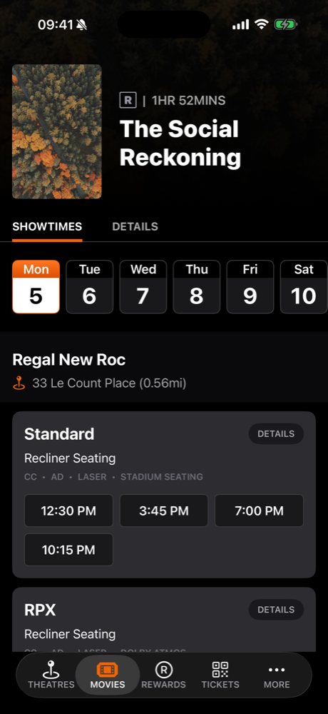
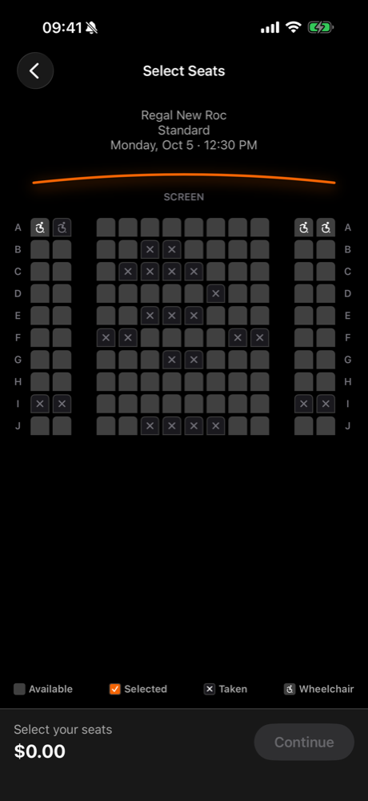
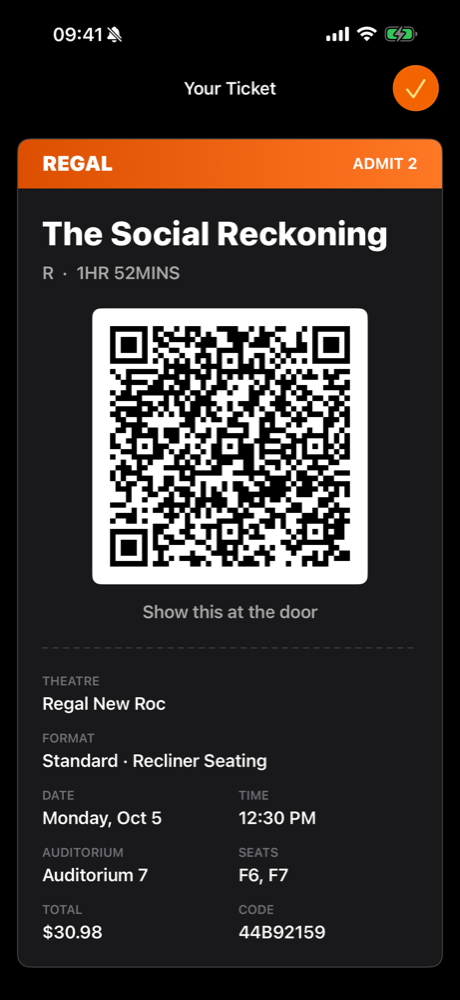
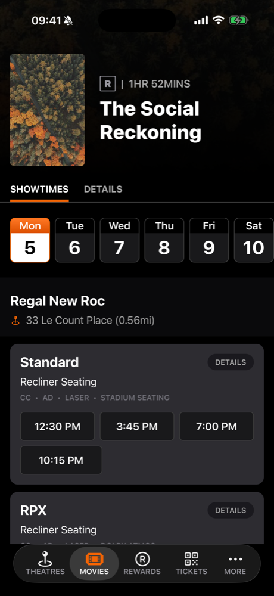
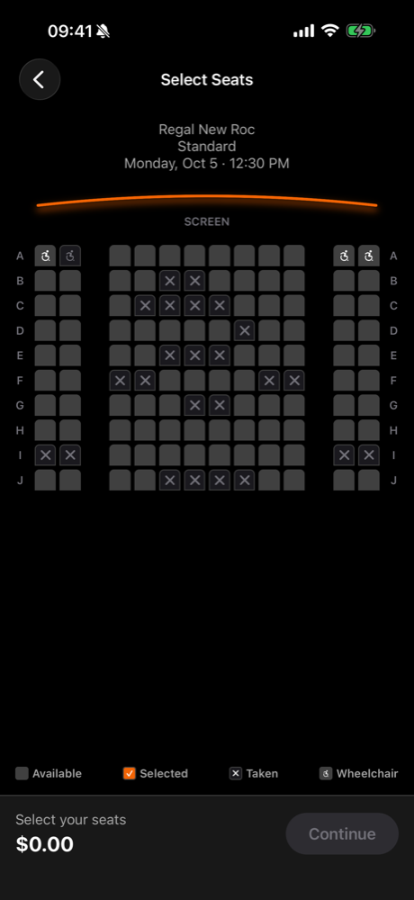
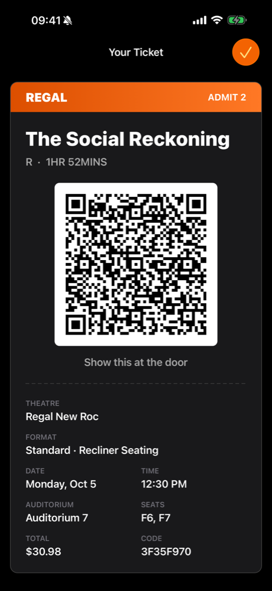

# Regal Cinemas

<p align="center">
  
</p>

<p align="center"><i>Live-coding app (primary) + Swift &rarr; Expo POC (background).</i></p>

**Primary:** `regal-live-coding/` — an Expo SDK 58 app built for the Regal Cinemas live-coding prompt
([`Candidate Prompt.pdf`](regal-live-coding/Candidate%20Prompt.pdf)): a browsable carousel of movies released in a
4-week window (today fixed at March 18, 2026), a movie detail screen, and a selectable 4-week release window,
all against the local Movie API served from `regal-live-coding/movie-mock-api/` on `:3001`.

**Background:** `regal-swift/` and `regal-expo/` — the same "Get Tickets" feature built twice (Swift/UIKit, then
ported to React Native + Expo), written before the live coding as a POC. See
[Background: Swift → Expo POC](#background-swift--expo-poc) below.

- `regal-live-coding/`: Expo SDK 58, New Architecture, expo-router, TypeScript strict, React Query, zod at the API boundary.
- `regal-swift/`: UIKit, Swift 6 (strict concurrency), MVVM + Coordinator, XcodeGen.
- `regal-expo/`: Expo SDK 58, New Architecture, expo-router, TypeScript strict, one local Expo Module (`ticket-kit`).

## Live coding: prompt → implementation

| Prompt requirement | Implementation | Commit |
| --- | --- | --- |
| 1. Fetch `GET /movies`, past 4 weeks from 2026-03-18, `primary_release_date_gte/lte` | [`movieRepository.ts`](regal-live-coding/src/repositories/movieRepository.ts), [`releaseWindow.ts`](regal-live-coding/src/domain/releaseWindow.ts) | 7, 9 |
| 2. Carousel: poster, title, release date, swipe navigation, tap to detail | [`MovieCarousel.tsx`](regal-live-coding/src/components/MovieCarousel.tsx), [`MoviesCarouselContext.tsx`](regal-live-coding/src/context/MoviesCarouselContext.tsx), [`app/(tabs)/index.tsx`](regal-live-coding/app/%28tabs%29/index.tsx) | 10–11 |
| 3. Detail page: poster, title, release date, overview, rating, director/cast, plot summary (+ runtime, rating, tagline, genres, backdrop) | [`useMovieDetailViewModel.ts`](regal-live-coding/src/viewmodels/useMovieDetailViewModel.ts), [`app/movie/[id].tsx`](regal-live-coding/app/movie/%5Bid%5D.tsx) | 13–14 |
| 4. (Optional) Any 4-week span between Jan 9 and May 8, 2026; user-friendly dates | [`ReleaseWindowPicker.tsx`](regal-live-coding/src/components/ReleaseWindowPicker.tsx) | 12 |
| Technical: HTTP, loading/error states, responsive | [`client.ts`](regal-live-coding/src/api/client.ts), [`states.tsx`](regal-live-coding/src/components/states.tsx), `useWindowDimensions` in carousel/detail | 2, 6, 11 |

### Where to look first (live coding)

1. [`schemas.ts`](regal-live-coding/src/api/schemas.ts): the zod contract. Types are inferred, never hand-duplicated; json-server's string/number ID drift is normalized in one place.
2. [`config/api.ts`](regal-live-coding/src/config/api.ts): base-URL resolution for web, iOS Simulator, Android emulator (`10.0.2.2`) and physical devices (Metro `hostUri`), so `localhost:3001` never leaks into a device build.
3. [`movieRepository.ts`](regal-live-coding/src/repositories/movieRepository.ts): the data-source boundary. View models depend on this interface, never on endpoints.
4. [`releaseWindow.ts`](regal-live-coding/src/domain/releaseWindow.ts): pure 28-day window math (anchor, clamping, formatting) — no React imports, testable in isolation.
5. [`MovieCarousel.tsx`](regal-live-coding/src/components/MovieCarousel.tsx): FlashList with snap + viewability-driven active movie; tap passes only the ID.
6. [`useMovieDetailViewModel.ts`](regal-live-coding/src/viewmodels/useMovieDetailViewModel.ts): rehydrates the detail screen by ID (deep-link safe), separates 404 from other errors, formats runtime/vote for the view.

### Built commit by commit

The live-coding app lands as atomic Conventional Commits, stricter than the POC below: each commit is one logical
concern, and each passes `tsc` and `expo lint` on its own in a clean checkout (verified per SHA in a detached
worktree). This docs commit (17) is the only one not linked below.

**Release** comes from [`@expo/fingerprint`](https://docs.expo.dev/versions/latest/sdk/fingerprint/) (iOS), recorded in
each commit's trailers — the same convention as the POC. A changed hash means the merge needs a new native build
(EAS Build + store); an unchanged hash means it ships as an OTA update (EAS Update).

| # | Commit | Why | Release |
| --- | --- | --- | --- |
| 1 | [`chore(live-coding): scaffold Expo SDK 58 + expo-router`](https://github.com/gg-ballin/regal-swift-to-expo/commit/549865c24a57c358afe9e8aa76f8a4081e4160a2) | Ship every native dependency in one binary | **Native build** `8e549a5` |
| 2 | [`feat(theme): design tokens + shared screen states`](https://github.com/gg-ballin/regal-swift-to-expo/commit/b6885e1493fca755758fbbed259c4fe1c93467da) | Tokens ported from the POC theme; Loading/Error/Empty states | OTA `8e549a5` |
| 3 | [`feat(app-shell): Regal header + root/tab navigation`](https://github.com/gg-ballin/regal-swift-to-expo/commit/54c33d3fa3b088621061df53495cd8f7a41e025b) | Branded header, tab bar, stack | OTA `8e549a5` |
| 4 | [`feat(data): API base-URL resolution`](https://github.com/gg-ballin/regal-swift-to-expo/commit/611de83fdcdcd616f862f0389b3f1cb39cc8027e) | One place that knows about `:3001` hosts | OTA `8e549a5` |
| 5 | [`feat(data): zod movie contract`](https://github.com/gg-ballin/regal-swift-to-expo/commit/6a527f38e83749c5142cda2d49301bd71a7c6ee2) | Validate at the boundary | OTA `8e549a5` |
| 6 | [`feat(data): typed HTTP client`](https://github.com/gg-ballin/regal-swift-to-expo/commit/ffff873d694574af02ecec318a48a15fc170efd3) | Timeout, `ApiError`, request logging | OTA `8e549a5` |
| 7 | [`feat(data): movie repository`](https://github.com/gg-ballin/regal-swift-to-expo/commit/f8e5722c9831d868fba8675733b2642a4413588b) | Endpoint seam for view models | OTA `8e549a5` |
| 8 | [`feat(api): API health diagnostic tab`](https://github.com/gg-ballin/regal-swift-to-expo/commit/160d09fc5b6023284500a5e4d65f6d98ace82e4b) | First diagnostic when the mock server is unreachable | OTA `8e549a5` |
| 9 | [`feat(domain): 28-day release-window logic`](https://github.com/gg-ballin/regal-swift-to-expo/commit/7ef687aa7eba434e429f810a5e78767a8c6c5552) | Prompt date rules as pure functions | OTA `8e549a5` |
| 10 | [`feat(movies): carousel state + FlashList carousel`](https://github.com/gg-ballin/regal-swift-to-expo/commit/90a002fb612e4e4e31e0e3eefaeb2abecf30e07e) | Swipeable poster rail, active-movie tracking | OTA `8e549a5` |
| 11 | [`feat(movies): Coming Soon list screen`](https://github.com/gg-ballin/regal-swift-to-expo/commit/4c943a04d91e2c0e3ddcceea1cd2403d7d772e0f) | `GET /movies` over the default window, all four states | OTA `8e549a5` |
| 12 | [`feat(movies): release-window date picker`](https://github.com/gg-ballin/regal-swift-to-expo/commit/39a667d58eb59d8ed431d4f1b82e812fa25f1ab3) | Optional prompt clause: any 4-week span | OTA `8e549a5` |
| 13 | [`feat(movie-detail): detail view model`](https://github.com/gg-ballin/regal-swift-to-expo/commit/fc98dfe0acca3a578c58a9095031458962441efe) | Formatting + error semantics off the view | OTA `8e549a5` |
| 14 | [`feat(movie-detail): detail screen`](https://github.com/gg-ballin/regal-swift-to-expo/commit/9a6c2c885b734a823a8b4a778ba31603bdf334a8) | Full prompt field set, backdrop→poster fallback | OTA `8e549a5` |
| 15 | [`feat(tickets): placeholder My Tickets tab`](https://github.com/gg-ballin/regal-swift-to-expo/commit/05eefedc2a858c3f00dfa25039d29ec09cae66e1) | Tab parity; bookings land here later | OTA `8e549a5` |
| 16 | [`chore(mock): vendor movie-mock-api fixture + yarn mock`](https://github.com/gg-ballin/regal-swift-to-expo/commit/2c37febde85c4eb05b245ec28e8bddb413a85d69) | The API the app was built against, reproducible | none |
| 17 | `docs(live-coding): candidate prompt + root README entry` | Provenance and this document | none |

**1 of 15 app commits needed a native build** (`8e549a5`). Commit 1 sets the native baseline (SDK 58, dev client,
`@expo/ui`, FlashList); commits 2–15 are JS/TS only and keep fingerprint `8e549a5`. (HEAD reads `b0c6dbd` only
because commit 16 changed the `mock` script in `package.json`, which fingerprint hashes — no native change.)

```bash
# See the 17 live-coding commits (path-scoped, works on any branch after merge)
git log --oneline -- regal-live-coding/
# Same, with release trailers (Release / Fingerprint per commit)
git log --format='%h %s | %(trailers:key=Release,valueonly) | %(trailers:key=Fingerprint,valueonly)' -- regal-live-coding/
cd regal-live-coding && npx @expo/fingerprint fingerprint:generate --platform ios   # reproduce a hash
```

### Run it (live coding)

```bash
cd regal-live-coding && yarn install
yarn mock   # terminal 1: Movie API on :3001 (json-server, movie-mock-api/)
yarn dev    # terminal 2: Metro for the dev client (yarn expo run:ios once, for the native build)
yarn tsc --noEmit && yarn expo lint
```

The API tab inside the app is the connectivity check: if it cannot reach `:3001`, the mock server is not running or
the host resolution in `config/api.ts` does not match the target (simulator vs. emulator vs. device).

### Next (live coding)

Tests for the pure logic in `releaseWindow.ts`, pagination with `useInfiniteQuery`, and persisted query cache for
offline launches.

---

## Background: Swift → Expo POC

<p align="center">
  
  &nbsp;&nbsp;&nbsp;<b>&rarr;</b>&nbsp;&nbsp;&nbsp;
  
</p>

<p align="center"><i>Small POC of a Swift app ported to React Native with Expo.</i></p>

The same "Get Tickets" feature built twice: once in **Swift / UIKit**, once in **React Native + Expo**.
The Expo app uses Expo libraries first and keeps native code only where the platform owns the capability. That native code is the UIKit app's own `CaptureObserver`, shared as the same Swift file.

<table>
  <tr><th></th><th>Movie detail</th><th>Seat selection</th><th>Ticket</th></tr>
  <tr>
    <th>Swift</th>
    <td></td>
    <td></td>
    <td></td>
  </tr>
  <tr>
    <th>Expo</th>
    <td></td>
    <td></td>
    <td></td>
  </tr>
</table>

### Where to look first (POC)

1. [`ticket-kit/ios/TicketKitModule.swift`](regal-expo/modules/ticket-kit/ios/TicketKitModule.swift): the whole native surface of the Expo app. Main-queue reads, listener-scoped observation, no retain cycles.
2. [`TicketKitCore/CaptureObserver.swift`](regal-swift/TicketKitCore/CaptureObserver.swift): the Swift file both apps compile. The module links it through a symlink instead of rewriting it.
3. [`useTicketScreenProtection.ts`](regal-expo/src/features/ticket/useTicketScreenProtection.ts): the `viewWillAppear` / `viewWillDisappear` + `NotificationCenter` lifecycle, ported to focus effects and `AppState`.
4. [`domain/seatSelection.ts`](regal-expo/src/domain/seatSelection.ts): business rules as pure functions, with [tests](regal-expo/src/features/seatSelection/seatSelection.test.tsx) named after the XCTests.
5. [`SeatCell.tsx`](regal-expo/src/features/seatSelection/components/SeatCell.tsx): one store selector per seat, so a tap re-renders one cell, not 120.
6. [`store/booking.ts`](regal-expo/src/store/booking.ts): Zustand + MMKV. Only purchased tickets persist, never the in-progress selection.

**Reading guide:** `// SWIFT:` comments in the Expo code name the UIKit construct each line replaces, so a Swift reviewer can read the port side by side.

### Built PR by PR (POC)

The Swift app is committed in one piece. The Expo app is committed as eight steps, each the size of a reviewable PR, each passing `tsc`, `expo lint` and `jest` on its own. The history was rebuilt into these steps for review, so commit dates are not development dates.

**Release** comes from [`@expo/fingerprint`](https://docs.expo.dev/versions/latest/sdk/fingerprint/) (iOS), recorded in each commit's trailers. A changed hash means the merge needs a new native build (EAS Build + store). An unchanged hash means it ships as an OTA update (EAS Update).

| #   | PR                                                                                                                             | Why                                      | Release                    | Size  | Review focus                             |
| --- | ------------------------------------------------------------------------------------------------------------------------------ | ---------------------------------------- | -------------------------- | ----- | ---------------------------------------- |
| 0   | [Swift app + TicketKitCore](https://github.com/gg-ballin/regal-swift-to-expo/commit/f303c634818759e42f25c10a0cd3d5868b2687cd)  | The reference behavior                   | App Store                  | +4303 | Baseline, not part of the port           |
| 1   | [Scaffold + native baseline](https://github.com/gg-ballin/regal-swift-to-expo/commit/34bc142beb6fe5b15bbe3cdd381945c4cec7450a) | Ship every native library in one binary  | **Native build** `97f31b2` | +330  | Conventions, routing, dependency choices |
| 2   | [Data contract](https://github.com/gg-ballin/regal-swift-to-expo/commit/130ef94ce099d47238b4eade0ce8019234dbe50e)              | Validate data at the boundary            | OTA `97f31b2`              | +247  | zod schemas, repository seam             |
| 3   | [Domain rules + store](https://github.com/gg-ballin/regal-swift-to-expo/commit/d84d516217996a4cb2e15aae52b2767e00843bc5)       | Money and seat rules as pure functions   | OTA `97f31b2`              | +706  | Rules, what persists and what doesn't    |
| 4   | [Movie detail](https://github.com/gg-ballin/regal-swift-to-expo/commit/904d2dc1cb513fb3d31e65d2d2efe6213fd45670)               | Entry screen, list pattern               | OTA `97f31b2`              | +725  | Row union, IDs-only navigation           |
| 5   | [Seat selection](https://github.com/gg-ballin/regal-swift-to-expo/commit/106c1a9fa8880d8dc900651b5da2038a13129241)             | 120 seats, instant taps                  | OTA `97f31b2`              | +592  | Per-cell selectors, haptics, a11y        |
| 6   | [Ticket (JS only)](https://github.com/gg-ballin/regal-swift-to-expo/commit/3cd1d3607a45066f03181683847285327daa942e)           | Offline QR, brightness, screenshot alert | OTA `97f31b2`              | +656  | Focus-scoped side effects                |
| 7   | [ticket-kit Expo Module](https://github.com/gg-ballin/regal-swift-to-expo/commit/b93af3db64552d51693c6583fc91e76402362ce0)     | The one gap Expo doesn't cover           | **Native build** `f7017df` | +311  | Swift boundary, lifecycle, fallback      |
| 8   | [Ticket history + demo link](https://github.com/gg-ballin/regal-swift-to-expo/commit/926b40d98afd73a9e55271e9d5240b2ab8b41224) | Tickets survive restarts                 | OTA `f7017df`              | +245  | Persistence, dev tooling                 |

**2 of 8 Expo PRs needed a native build.** PR 1 sets the native baseline. PR 7's hash changed for exactly two reasons: `modules/ticket-kit/ios` and the iOS autolinking config. Sizes exclude the lockfile and JSON fixtures.

```bash
# See the 9 POC commits (1 Swift + 8 Expo, path-scoped)
git log --oneline -- regal-swift/ regal-expo/
# Same, with release trailers (Release / Fingerprint per commit)
git log --format='%h %s | %(trailers:key=Release,valueonly) | %(trailers:key=Fingerprint,valueonly)' -- regal-swift/ regal-expo/
cd regal-expo && npx @expo/fingerprint fingerprint:generate --platform ios   # reproduce a hash
```

<details>
<summary><b>1. Scaffold + native baseline</b></summary>

- Expo SDK 58, TypeScript strict, expo-router with `NativeTabs` (a real `UITabBarController`), dev client with Continuous Native Generation (no `ios/` committed).
- Every native library the v1 binary needs lands here, so the feature PRs after it stay JS-only.
- `theme.ts` ported from `Theme.swift`. [`AGENTS.md`](regal-expo/AGENTS.md) holds the rules AI coding agents follow in this repo (versioned Expo docs, `expo install` only, lint and typecheck before done).
</details>

<details>
<summary><b>2. Data contract</b></summary>

- zod schemas replace the Swift `Codable` models; types are inferred from them.
- Same `MovieRepository` interface as Swift, injected through context so tests swap in a fake.
- The bundled JSON is a copy of `regal-swift/MockData`, and a test fails if they drift.
</details>

<details>
<summary><b>3. Domain rules + store</b></summary>

- Seat toggle rules, ordering, totals in integer cents, ticket building, and a QR payload with sorted keys, so both apps encode the same string.
- No React or platform imports: testable without a simulator, reusable on web.
- Zustand store with MMKV persistence for purchased tickets only.
</details>

<details>
<summary><b>4. Movie detail</b></summary>

- One FlashList v2 whose rows are a discriminated union, the equivalent of the Swift diffable data source (stable keys, one item type per cell registration).
- Navigation passes IDs only, and the next screen rehydrates from the cache, so deep links and process death work.
- Tab underline animated on the UI thread with Reanimated.
</details>

<details>
<summary><b>5. Seat selection</b></summary>

- Each seat subscribes to its own store slice, the equivalent of `reconfigureItems` on the changed item only.
- Haptics on toggle, plus warning + alert + VoiceOver announcement at the seat limit.
- Tests port `SeatSelectionViewModelTests` with the same test names.
</details>

<details>
<summary><b>6. Ticket (JS only)</b></summary>

- QR via `toqr` (error correction M, same as CoreImage), drawn as one SVG path. Same code on iOS, Android and web.
- Brightness boosts on focus and restores on blur and on background, because brightness is system-wide.
- Screenshot alert through `expo-screen-capture`. The capture shield UI is ready; PR 7 drives it.
</details>

<details>
<summary><b>7. ticket-kit Expo Module</b></summary>

- `isCaptured()` and an `onCaptureChange` event over `CaptureObserver`. Observation starts with the first JS listener and stops with the last one (`OnStartObserving` / `OnStopObserving`).
- `<SecureView>` hides only the QR from screenshots and recordings; `expo-screen-capture` can only protect the whole window.
- Android and web get the same JS contract: Android blocks capture with `FLAG_SECURE`, web is a no-op.
</details>

<details>
<summary><b>8. Ticket history + demo link</b></summary>

- TICKETS tab reads the persisted store; tickets survive an app restart.
- `useDemoRoute` mirrors the Swift `-demoRoute seats|ticket` launch argument, used for the screenshots above.
</details>

### Swift to Expo, side by side

| Concern                          | Swift (UIKit)                           | Expo                                                     |
| -------------------------------- | --------------------------------------- | -------------------------------------------------------- |
| Navigation                       | Coordinator + `UINavigationController`  | expo-router native stack + `NativeTabs`                  |
| Route arguments                  | Objects in memory                       | IDs, rehydrated from cache or store                      |
| Screen state                     | `@MainActor` ViewModel + `onChange`     | Hook (logic) + Zustand selectors (state)                 |
| Business rules                   | Inside ViewModels                       | Pure TypeScript in `src/domain`                          |
| Data                             | `MovieRepository` + `Codable`           | Same repository, zod at the boundary, React Query cache  |
| Lifecycle                        | `viewWillAppear` / `NotificationCenter` | `useFocusEffect` + `AppState`                            |
| Brightness, haptics, screenshots | `TicketKitCore`                         | `expo-brightness`, `expo-haptics`, `expo-screen-capture` |
| QR                               | CoreImage                               | `toqr` + `react-native-svg`                              |
| Recording detection              | `CaptureObserver`                       | The same `CaptureObserver`, through `ticket-kit`         |

### Trade-offs (POC)

- **iOS detects, Android blocks.** iOS shows a shield while recording (parity with the Swift UX). Android has no recording detection without Kotlin, so it blocks capture with `FLAG_SECURE`. Switching iOS to blocking would remove the last native code, but change the UX.
- **One repo** so both apps share `TicketKitCore` and the JSON through symlinks. At company scale, `TicketKitCore` would be a versioned Swift Package used by the native app and by the module's podspec.
- **Brightness is system-wide**, so it is restored on blur and on background, not only on unmount.
- **`<SecureView>`** relies on the secure text field canvas, since UIKit has no public API for this. If iOS changes it, the QR still renders, just unprotected.

### Run it (POC)

```bash
# Swift
cd regal-swift && xcodegen generate
xcodebuild test -project RegalNative.xcodeproj -scheme RegalNative \
  -destination 'platform=iOS Simulator,name=iPhone 16'

# Expo (development build; the local module rules out Expo Go)
cd regal-expo && npm ci
npx expo run:ios
npx tsc --noEmit && npx expo lint && npx jest
```

Brightness and haptics only work on a device. Screenshots can be triggered in the Simulator under Device > Trigger Screenshot.

### Next (POC)

PassKit (Add to Wallet), Apple Pay and Live Activities as Expo Modules, with Kotlin counterparts for Android. More detail in [`docs/REGAL_PORT_POC_PLAN.md`](docs/REGAL_PORT_POC_PLAN.md).
